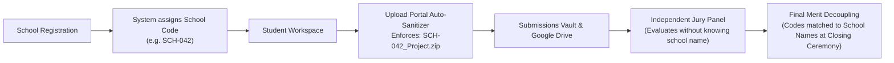

# GNE'S APEX 2026 — Institutional, Operational & Competition Context

> **Guru Nanak Dev Engineering College, Ludhiana**  
> **Organized by Causmic Club (Department of Computer Science & Engineering)**  
> **Comprehensive Event Dossier & Operational Context**  

---

## 1. Institutional Background & Legacy

### 1.1. Host Institution: Guru Nanak Dev Engineering College (GNDEC)
- **Establishment**: Founded in **1953** by the historic **Nankana Sahib Education Trust (NSET)**, GNDEC is one of Northern India’s oldest, most revered engineering institutions.
- **Location**: Gill Park, Gill Road, Ludhiana, Punjab, India (PIN: 141006).
- **Accreditation & Autonomy**:
  - Autonomous College under UGC Act.
  - Accredited with **NAAC Grade 'A+'**.
  - All undergraduate technical courses accredited by the **National Board of Accreditation (NBA)** under the Washington Accord.
  - Affiliated with I.K. Gujral Punjab Technical University (IKGPTU), Jalandhar.
- **Campus Facilities**: Sprawling 88-acre green campus equipped with multi-gigabit fiber optic network infrastructure, advanced computing centers, and high-density laboratory clusters.

### 1.2. Organizing Body: Causmic Club
- **Parent Department**: Department of Computer Science & Engineering (CSE).
- **Mission**: Causmic Club is the premier student-led technical body of GNDEC, fostering software development, creative design, competitive coding, open-source innovation, and technical leadership among student engineers.
- **Key Leadership & Event Contacts**:
  - **Prompt Engineering Event Head**: Saksham (+91 98884 78606)
  - **Core Student Coordinators**: Ishmeet Singh, Harleen Kaur, and the Causmic Club Technical Steering Team.
  - **Faculty Mentors**: Senior Faculty, Department of Computer Science & Engineering, GNDEC.

---

## 2. Event Overview: GNE'S APEX 2026

**GNE'S APEX 2026** is the flagship inter-school technical, digital creation, and innovation conclave organized by GNDEC Ludhiana. The event draws hundreds of enthusiastic students from secondary and senior secondary schools (Classes 9th through 12th) across Punjab and neighboring states.

### Core Objectives
1. **Practical Digital Competency**: Move beyond theoretical IT syllabi into real-time, on-the-spot software development, visual design, and artificial intelligence reasoning.
2. **Stress-Tested Fair Evaluation**: Guarantee 100% impartial judging through automated blind judging codes, preventing bias based on school reputation or institutional affiliation.
3. **Seamless Digital Experience**: Eliminate archaic pen-and-paper or USB flash drive submissions through a state-of-the-art web portal engineered specifically for multi-lab concurrency.

---

## 3. High-Density Laboratory Environment Realities

Developing software for school competitions presents unique environmental challenges that the APEX portal is specifically engineered to overcome:

```
┌─────────────────────────────────────────────────────────────────────────┐
│                     LAB ENVIRONMENT CHALLENGES                          │
├───────────────────────────────────┬─────────────────────────────────────┤
│ 1. Network & Bandwidth Clamping   │ 200 workstations hitting external   │
│                                   │ cloud hosts simultaneously can      │
│                                   │ saturate local ISP uplinks.         │
├───────────────────────────────────┼─────────────────────────────────────┤
│ 2. Air-Gapped / Proxy Constraints │ School computer labs frequently use │
│                                   │ strict proxy filters, blocking raw  │
│                                   │ WebSockets or external CDNs.        │
├───────────────────────────────────┼─────────────────────────────────────┤
│ 3. Browser Variance & Outdated OS │ Lab workstations may run legacy     │
│                                   │ Windows versions or older browsers. │
├───────────────────────────────────┼─────────────────────────────────────┤
│ 4. Single-Point Failure Risks     │ If external internet drops during   │
│                                   │ the 90-minute competition, work     │
│                                   │ must NOT be lost.                   │
└───────────────────────────────────┴─────────────────────────────────────┘
```

### Engineered Solutions in APEX 2026:
- **Zero External Dependencies**: The server runs natively on raw Node.js with zero `npm` requirements.
- **In-Memory RAM Asset Caching**: 100% of HTML, CSS, JS, and image assets are cached in RAM, serving 200+ clients with `<1.2ms` response times over internal Gigabit LAN.
- **HTTP/SSE Transport**: Uses pure HTTP/1.1 Server-Sent Events rather than heavy WebSockets, effortlessly penetrating school firewall proxies.
- **Dual-Vault Redundancy**: Submissions are committed to local disk storage first. Cloud syncing to Google Drive occurs asynchronously in the background.

---

## 4. Active Competition Tracks In-Depth

### 4.1. Track 1: Web Wizards (Group Event)
- **Team Size**: Exactly 2 participants per school team.
- **Duration**: **90 Minutes** (Continuous countdown).
- **Core Challenge**: Teams are presented with an on-the-spot theme (revealed at the start of the timer) and must code a fully responsive, visually captivating multi-section website from scratch.
- **Permitted Technologies**: HTML5, CSS3, Vanilla JavaScript, embedded assets provided in the official asset package (`assets/web-wizards-assets.zip`). External frameworks and templates are disallowed unless explicitly authorized.
- **Deliverable**: A single `.ZIP` archive containing all code, CSS, JS, and local media. Max size: **50 MB**.
- **Required File Naming**: `[SCHOOLCODE]_WebWizards.zip` (e.g., `SCH042_WebWizards.zip`).
- **Evaluation Criteria**:
  1. *Visual Appeal & Design Elegance* (30%): Typography, color harmony, visual polish, and layout structure.
  2. *Responsive Adaptability* (25%): Seamless rendering across desktop, tablet, and mobile viewport widths.
  3. *Adherence to Spot Theme* (25%): Effective communication and conceptual execution of the assigned theme.
  4. *Code Quality & Structure* (20%): Semantic HTML5 markup, clean CSS architecture, and error-free JavaScript.

---

### 4.2. Track 2: Digital Identity (Individual Event)
- **Team Size**: Exactly 1 participant per school.
- **Duration**: **60 Minutes** (Continuous countdown).
- **Core Challenge**: Design a distinctive, conceptual brand logo and visual identity based on the on-the-spot problem brief.
- **Permitted Tools**: Canva, Figma, Google Slides, Adobe Illustrator, Adobe Photoshop, or open-source raster/vector packages.
- **Deliverable**: High-resolution image file (`.PNG`, `.JPG`) or vector document (`.PDF`).
- **Required Dimensions**: Exactly **800 × 800 Pixels** (aspect ratio 1:1). The upload portal includes an active client-side canvas pre-flight check that alerts participants if their file deviates from this resolution.
- **Max File Size**: **50 MB**.
- **Required File Naming**: `[SCHOOLCODE]_DigitalIdentity.png` (or `.jpg` / `.pdf`).
- **Evaluation Criteria**:
  1. *Conceptual Depth & Originality* (35%): Creative metaphor, uniqueness of concept, and thematic relevance.
  2. *Visual Balance & Composition* (25%): Golden ratio, symmetry, negative space usage, and readability.
  3. *Color Psychology & Typography* (25%): Purposeful color harmony and appropriate font selection.
  4. *Technical Precision* (15%): Sharp vector edges, proper 800×800 dimensions, and clean export quality.

---

### 4.3. Track 3: Prompt Engineering (Individual Event)
- **Team Size**: Exactly 1 participant per school.
- **Duration**: **60 Minutes**.
- **Core Challenge**: Tackle complex, real-world computational and analytical problem statements utilizing ChatGPT / Large Language Models. Participants must formulate structured multi-turn prompts, demonstrate prompt chaining, reasoning extraction (Chain-of-Thought), and hallucination mitigation.
- **Deliverable**: Comprehensive solution document (`.PDF`, `.DOCX`, `.TXT`, or `.ZIP`) containing full prompt transcripts, prompt breakdown, AI outputs, and final synthesis.
- **Max File Size**: **50 MB**.
- **Required File Naming**: `[SCHOOLCODE]_PromptEngineering.pdf` (or `.docx`, `.txt`, `.zip`).
- **Evaluation Criteria**:
  1. *Prompt Architecture & Clarity* (30%): Persona definition, context grounding, constraint specification, and few-shot formatting.
  2. *Output Accuracy & Problem Resolution* (30%): How completely and accurately the LLM solved the stated challenge.
  3. *Iterative Refinement & Prompt Chaining* (25%): Sophistication in guiding the model across multi-turn reasoning steps.
  4. *Safety, Hallucination Control & Verification* (15%): Demonstrating verification techniques to validate model accuracy.

---

## 5. The Blind Judging Protocol

To uphold the highest ethical standards of fairness, GNE'S APEX enforces a comprehensive **Blind Judging Protocol**:



1. **Anonymized Identity**: Upon check-in, each participating school is assigned a unique alphanumeric code (e.g., `SCH-042`, `101`, `102`).
2. **Strict Sanitization**: Participants are strictly instructed never to include their school name, crest, or student names within website headers, logos, or document bodies.
3. **Automatic File Prefixing**: If a student uploads a file named `my_project.zip`, the portal engine automatically prepends their school code, renaming the file to `SCH-042_my_project.zip`.
4. **Jury Isolation**: Evaluating judges only see the alphanumeric school code and the submitted work. School identities remain locked until final scores are tabulated.

---

## 6. End-to-End Operational Lifecycle

The competition follows a synchronized 6-phase chronological lifecycle:

```text
Phase 1: Lab Check-In & Network Handshake
├── Workstations booted and pointed to projected server URL (e.g. http://192.168.18.10:3000)
├── Browser opens index.html; persistent SSE stream established
└── Admin Console confirms workstation count (e.g. "128 Live Workstations Connected")

Phase 2: Briefing & Track Selection
├── Students navigate to their designated track (web-wizards.html, etc.)
└── Official rules, constraints, judging rubrics, and permitted tools reviewed

Phase 3: Synchronized Master Timer Start & Theme Reveal
├── Event Head enters admin passcode (apex2026) in admin.html
├── Event Head clicks "Start Competition Timer"
├── Server updates timer_state.json and broadcasts SSE event (<1ms)
├── Student clocks transition from "READY" to "RUNNING"
└── Spot themes and official asset packs (web-wizards-assets.zip) unlocked

Phase 4: Active Work & Real-Time Supervisor Broadcasts
├── Students design and code under synchronized countdown
└── Event Heads push live broadcast announcements (e.g., "15 minutes remaining!")

Phase 5: Validation, Dropzone Ingestion & Digital Receipts
├── Students drag completed file into upload portal
├── Frontend verifies file extension, size (<50MB), and image dimensions
├── File converted to Base64 and transmitted via POST /api/upload
├── Server writes binary to disk vault and appends to submissions_log.json & .csv
├── Non-blocking background HTTPS call relays file to designated Google Drive folder
└── Student receives verified digital receipt token (e.g. APEX26-WW-101-3405)

Phase 6: Countdown Expiry & Evaluation
├── Central 1-second server ticker detects countdown 0:00
├── Status transitions to "ENDED"; clocks turn crimson
└── Judges access submissions via local network or Google Drive evaluation folders
```

---

## 7. Submission Vault Audit Log Example

A live sample from `submissions/submissions_log.json` showing validated entries from competing schools during the event:
```json
{
  "token": "APEX26-WW-101-3405",
  "event": "Web Wizards",
  "schoolCode": "101",
  "fileName": "101_Master_Projects_HeritageHub_and_EVolt.zip",
  "fileSizeBytes": 51883112,
  "savedPath": "C:\\Users\\karan\\Desktop\\GNE'S APEX\\submissions\\Web Wizards\\101_Master_Projects_HeritageHub_and_EVolt.zip",
  "timestamp": "2026-10-26T13:28:15.531Z",
  "formattedTime": "26/10/2026, 6:58:15 pm"
}
```
All logged submissions are permanently recorded in both JSON and CSV formats for immediate auditability and reconciliation.
